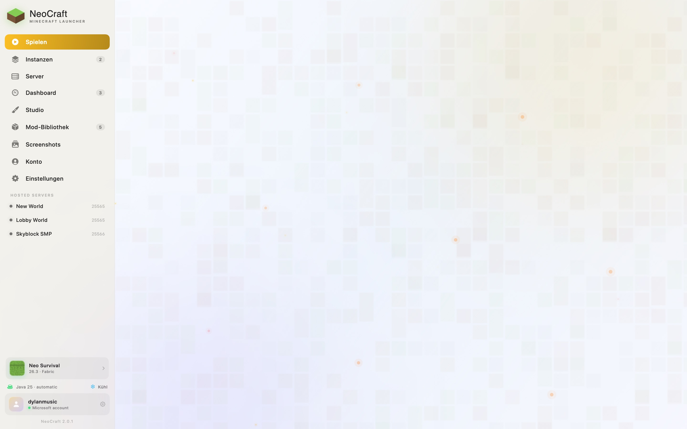
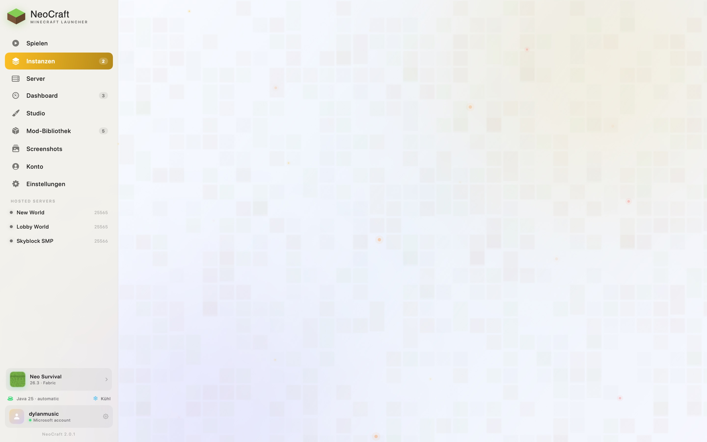
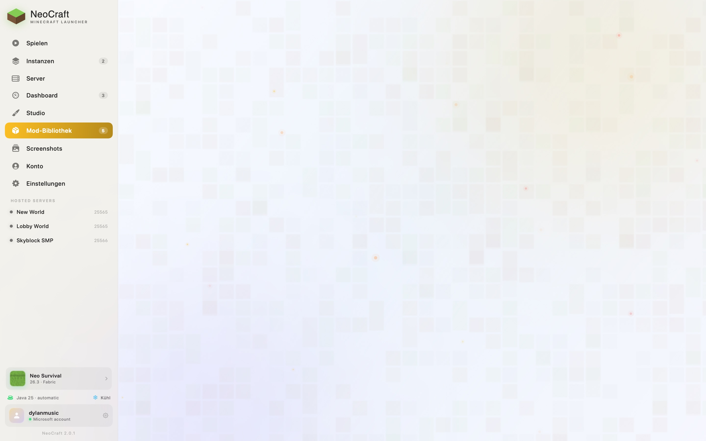
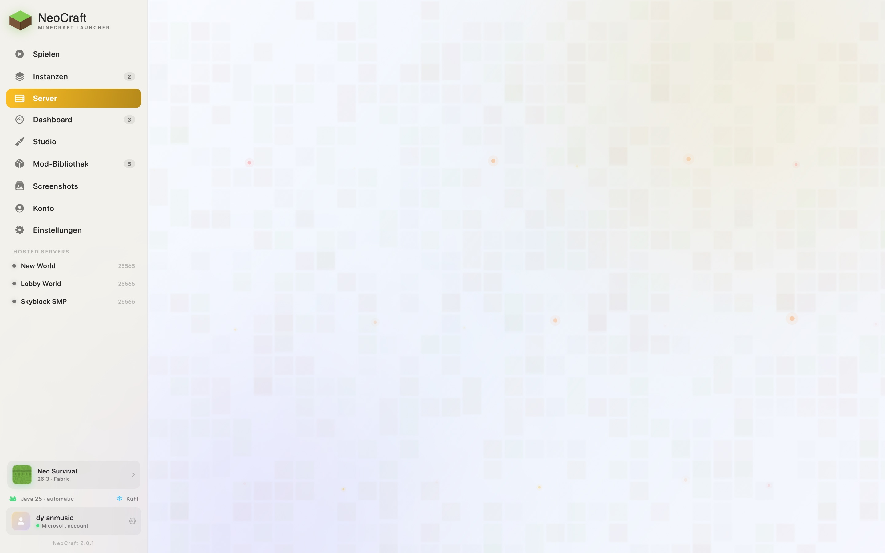
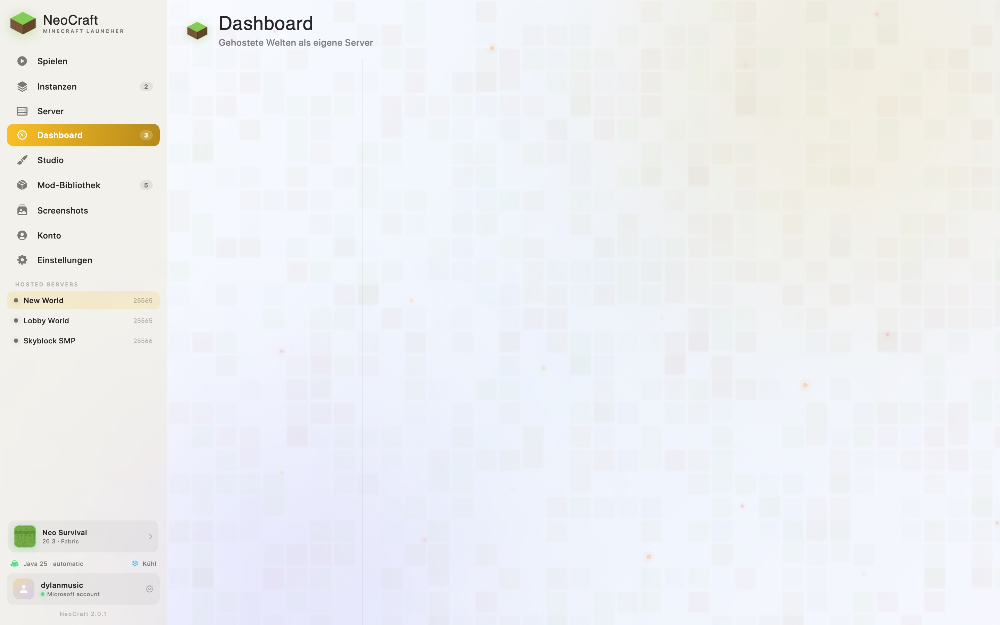
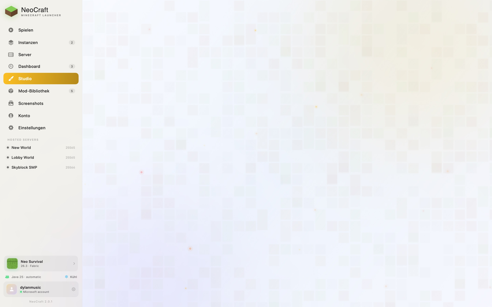
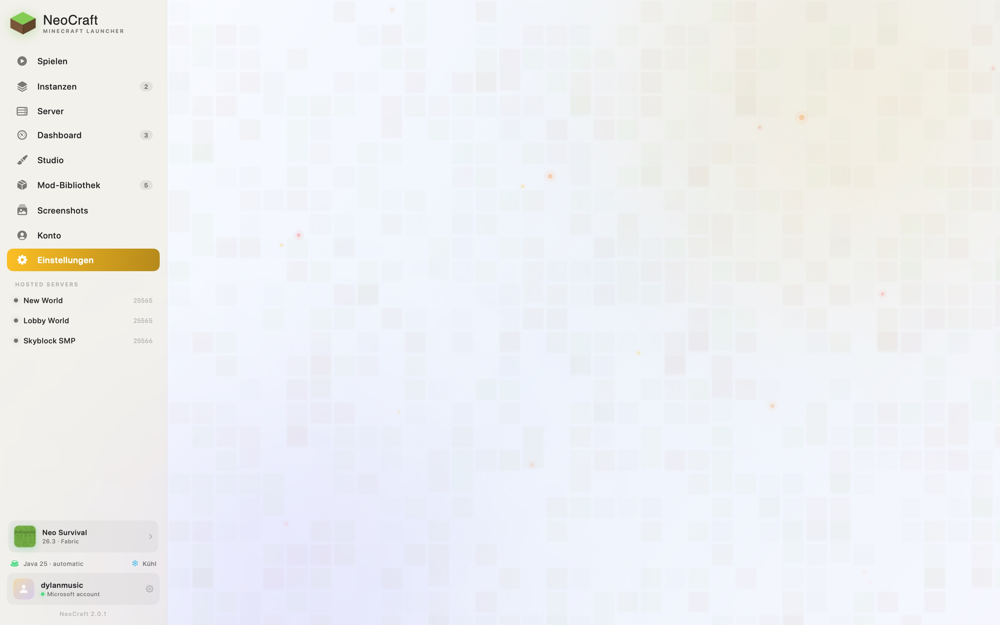
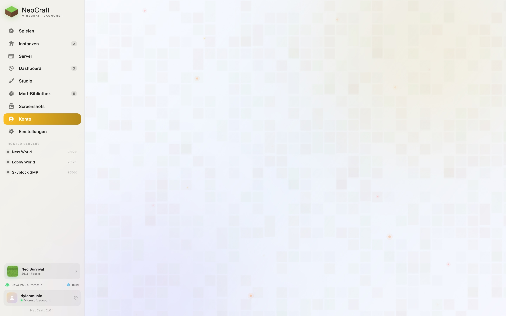

<div align="center">


# ⛏️ NeoCraft

### *Der native Minecraft-Launcher, den dein Mac verdient hat.*

**Minecraft: Java Edition — paved with Swift, fueled by magic.**

Ein Launch-Pad in Swift 6 + SwiftUI, gebaut für Apple Silicon und leise 8-GB-Macs.
Microsoft-Anmeldung, Mojang-Versionen, Fabric, Java-Installation, Modrinth —
alles wie von Zauberhand.

</div>

---

## ✨ Was NeoCraft kann

| | |
|---|---|
| 🎮 **Ein-Klick-Play** | Microsoft Device-Code-Login, Mojang-Versionen, Fabric-Loader, Neo Boost — bereit in einem Atemzug. |
| ☕ **Java, automatisch** | Eclipse Temurin JDK 21/25 wird selbstständig geladen — passgenau zur Minecraft-Version. |
| 📦 **Mod Library** | Modrinth-Suche mit Versions- & Fabric-Filtern, Dependency-Auflösung, One-Click-Install. |
| 🌍 **6 Sprachen** | Englisch, British English, Deutsch, Spanisch, Französisch, Russisch. |
| 🛏️ **Bedrock (Beta)** | Minecraft für Windows läuft nativ über Wine + D3DMetal — direkt aus der App, mit Performance-Modus für flüssige 60 fps auf 8-GB-Macs. |
| 🎨 **Studio** | Themes, Wallpapers, Akzente, Grid — dein Launcher, dein Stil. Frosted Glass bis OLED Dark. |
| 🌡️ **Kühl & leise** | 4,5 GB Heap, G1GC-Tuning, FPS-Cap & Render-Distance — dein MacBook bleibt kühl. |
| 📡 **Server Radar** | Server-Liste mit Live-Ping direkt im Launcher. |
| 🖥️ **Server-Tab** | Dedizierte Server-Verwaltung: Java (Vanilla/Paper/Fabric) **und** Bedrock Dedicated Server — erstellen, starten, stoppen, Plugins/Mods/Ressourcen, Presets, Backups, Welt-Import/Export, Update-Checks. |
| 📦 **Extensions** | Paper → Plugins, Fabric → Mods, Vanilla → Resource Packs — per Modrinth-Suche, URL oder Datei. |
| 🌍 **Server-Gruppen** | Server gruppieren, Akzentfarben, Presets (Survival, Creative, Minigame, Hardcore, SMP) mit einem Klick anwenden. |
| 📥 **Welt-Transfer** | Server-Welt als `.zip` exportieren oder aus einem Archiv ersetzen (Auto-Backup vorher). |
| 🧩 **Ingame-Mods** | Eigene Fabric-Mods: HUD-Widgets, Host-Panel und NeoCraft-Screen-Theme — konfigurierbar im Studio (Beta). |

### 🖥️ Server hosten — so geht's

1. **Server-Tab → New Server** — Java (Vanilla, Paper oder Fabric) oder
   Bedrock Dedicated Server (Beta), mit leerer Welt oder einer Welt aus
   einer Instanz.
2. Server im Dashboard starten — Live-Konsole, Spielerliste (Op/Kick),
   Start/Stop/Restart, `server.properties`-Editor, Dateibrowser,
   World-Backups, Extensions und Update-Check inklusive.
3. Freunde treten über `LAN-IP:Port` bei.

Presets (Survival, Creative, Minigame, Hardcore, SMP) schreiben die
`server.properties` in einem Klick — Gruppen und Akzentfarben halten
die Server-Liste übersichtlich.

---

## 🚀 Schnellstart — 60 Sekunden bis zum Bauen

```bash
# 1. NeoCraft holen
curl -LO https://github.com/dylanmusicc/NeoCraft/releases/latest/download/NeoCraft-2.1.3.pkg

# 2. Installieren (zieht die App nach /Applications)
open NeoCraft-2.1.3.pkg
```

> **Erster Start:** macOS fragt einmal nach Erlaubnis — **Rechtsklick → Öffnen**.
> Der Build ist ad-hoc signiert; mehr dazu unter [⚠️ Hinweise](#-warnungen--hinweise).

Dann: **Settings → Microsoft-Konto anmelden → Instanz erstellen → PLAY.**
Das richtige JDK lädt sich von allein. Fertig.

<details>
<summary>🖼️ Alternativ: DMG (Drag & Drop)</summary>

```bash
curl -LO https://github.com/dylanmusicc/NeoCraft/releases/latest/download/NeoCraft-2.1.3.dmg
open NeoCraft-2.1.3.dmg
# NeoCraft.app auf den Applications-Ordner ziehen
```

</details>

## 📸 Screenshots

<table>
  <tr>
    <td width="50%"></td>
    <td width="50%"></td>
  </tr>
  <tr>
    <td width="50%"></td>
    <td width="50%"></td>
  </tr>
  <tr>
    <td width="50%"></td>
    <td width="50%"></td>
  </tr>
  <tr>
    <td width="50%"></td>
    <td width="50%"></td>
  </tr>
</table>

---

## 🏗️ Aus dem Quellcode bauen

Voraussetzungen: macOS 14+, Apple Silicon, Xcode Command Line Tools (`xcode-select --install`).

```bash
git clone https://github.com/dylanmusicc/NeoCraft.git
cd NeoCraft
./build.sh          # baut build/NeoCraft.app
./build.sh --run    # baut und startet sofort
```

### Distribution-Artefakte

```bash
./scripts/MakePKG.sh   # → build/NeoCraft-<version>.pkg  (GUI-Installer)
./scripts/MakeDMG.sh   # → build/NeoCraft-<version>.dmg  (Drag & Drop)
```

Beide Installer tragen das NeoCraft-Design: Forest-Gradient, isometrischer
Grasblock, Pixel-Wordmark, App-Icon und die Silkscreen-Pixel-Schrift.
`MakeDMG.sh` braucht `python3 -m pip install dmgbuild` — der AppleScript-Weg
für DMG-Hintergründe ist seit macOS 26 kaputt.

---

## 🗺️ Architektur

```
Sources/NeoCraft/
├── App/           AppModel (Observable-Koordinator), App-Einstieg
├── Core/          Pfade, Netzwerk, Downloader, Persistenz, Keychain,
│                  System-Metriken, Logging, Instance-Scanner
├── Models/        Settings, Instanzen, Mojang/Fabric/Modrinth-DTOs
├── Services/
│   ├── Auth/      Microsoft Device-Code → Xbox Live → XSTS → Minecraft
│   ├── Game/      Versionsmanifest, Installer, Java-Manager,
│   │              Launch-Planer, Options-Tweaker, Prozess-Supervision
│   └── Modrinth/  v2-API, Dependency-Resolver, Neo-Boost-Installer
└── Views/         Root, Sidebar, vier Produkt-Bereiche, Sheets,
                   Design-System
```

**Concurrency:** Swift 6 Strict Concurrency — Services sind Actors,
UI-State ist `@MainActor @Observable`, Downloads laufen über ein
geteiltes `URLSession`-Fast-Path plus Delegate-Session mit Fortschritt.

**Daten:** Alles liegt in `~/Library/Application Support/NeoCraft/`
(State, Shared-Libraries, Runtime-JDKs, Instanzen, Logs). Tokens
sicher im **macOS Keychain**, nie in `state.json`.

---

## 🎮 Im Spiel

| Taste | Aktion |
|---|---|
| `N` | NeoCraft-Menü (Server, Design, HUD) |
| `Right Shift` | HUD-Editor öffnen (Beta) |
| `F8` | HUD an/aus (Beta) |
| `K` | NeoCraft Host-Panel (Beta) |

Das `neocraft-ui`-Mod ist auf jeder Fabric-Instanz aktiv: Es theme't
Title-, Pause-, Death- und Options-Screens im NeoCraft-Look (Farben und
Style synchron mit dem Launcher-Theme) und öffnet per `N` oder dem
NeoCraft-Button auf Title/Pause ein Menü mit Server-Verwaltung
(Host/Start/Stop über die Bridge), Theme-Editor und Mod-Status. Das
Menu spiegelt `config/neocraft_ui.json` — Studio → In-Game UI editiert
dasselbe Dokument. HUD und Host-Panel bleiben hinter dem Beta-Flag
„In-Game NeoCraft Mods" (Settings).

Performance-Defaults: `-Xmx4608M`, G1GC, `AlwaysPreTouch`, 60 FPS-Cap,
10-Chunks Render-Distance — optimiert für passiv gekühlte MacBooks.
Minecraft 1.20.5+ wird direkt in `options.txt` konfiguriert.

---

## ⚠️ Warnungen

- **Beta-Features** — experimentell; vor dem Aktivieren fragt die App nach einer Bestätigung. Kann instabil sein, Spielstände beschädigen oder sich ohne Vorankündigung ändern.
- **Inoffizielle Software** — Community-Launcher, kein offizielles Mojang/Microsoft-Produkt.
- **Keine Gewähr** — „as is" ohne Garantie. Details in Lizenz & Rechtlichem.
- **Account nötig** — ein legitimer Minecraft-Account (Microsoft-Login) ist erforderlich.
- **Server-Hosting** — für privaten, nicht-kommerziellen Gebrauch; öffentliche/monetarisierte Server können zusätzliche Lizenzen erfordern.
- **Drittanbieter-Inhalte** — zur Laufzeit geladene JDKs, Mods, Packs und Server-Software unterliegen den Lizenzen von Mojang, Adoptium, Fabric, Modrinth u. a.
- **Bedrock (Beta)** — benötigt macOS 27 und einen Microsoft-Account mit Minecraft für Windows.

## 📜 Rechtliches & Credits

Minecraft ist eine Marke von Mojang Synergies AB. NeoCraft steht in
keiner Verbindung zu Mojang, Microsoft, Fabric oder Modrinth.

- **NeoCraft** — Design, Code & Packaging vom NeoCraft-Projekt
- **Swift / SwiftUI** — Apple Inc.
- **Fonts** — PressStart2P by CodeMan38 · Silkscreen by Jason Kottke
- **dmgbuild** — dmgbuild contributors (DMG-Packaging)
- **Mojang Synergies AB** — Minecraft, Assets, server.jar, BDS
- **Eclipse Adoptium** — Temurin Java-Laufzeiten
- **Fabric MC** — Loader & Loader-Ökosystem
- **Modrinth** — Mod-/Plugin-/Pack-Index & API
- **Wine / D3DMetal** — führt Minecraft Bedrock & BDS unter macOS aus

Vollständige Lizenz-, Credit- und Haftungshinweise: im Lizenz-Screen
des Installers und in [`RELEASE_NOTES.md`](RELEASE_NOTES.md).

---

<div align="center">

**⛏️ Craft it. Play it. NeoCraft it.**

<sub>Made with Swift on Apple Silicon · Not affiliated with Mojang or Microsoft</sub>

</div>
